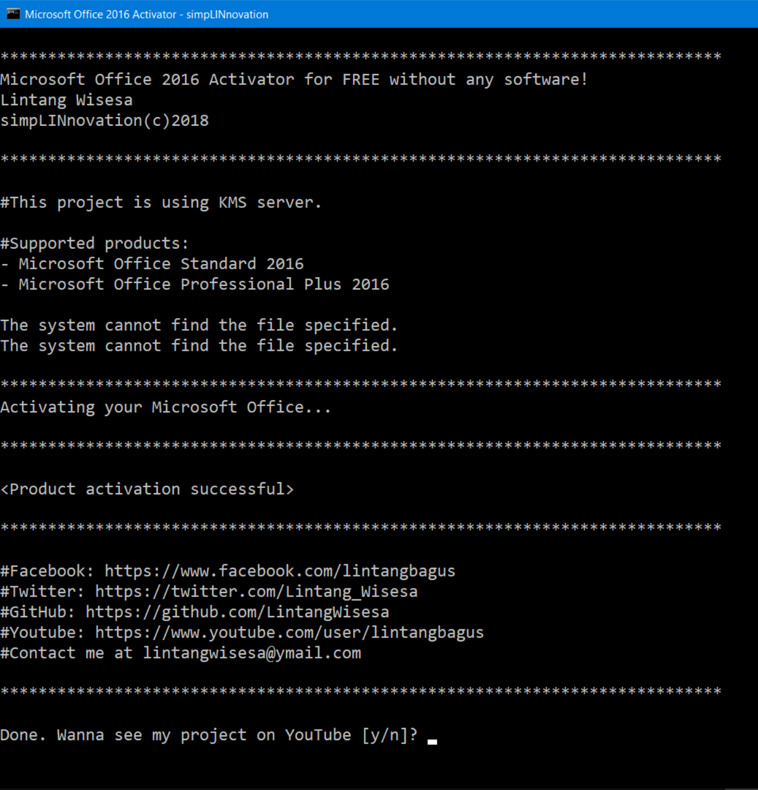

# Microsoft Office 2016 Activation Script — Security Tool

### 🚀 PowerShell Quick Install

   

---

A single batch file that activates Microsoft Office 2016 Standard and Professional Plus through a KMS server, requiring no additional software installation. The script detects the Office installation path, applies the appropriate volume license keys, and attempts activation against a list of KMS hosts in sequence. It operates entirely from the command line and reports success or failure for each host attempt. Administrative privileges and a working internet connection are required for the activation process to complete.

## ✅ Before You Start

- **OS:** Windows 10 / 11
- **Shell:** PowerShell 5.1+ or PowerShell 7+
- **Network:** internet access to download the script
- **Privileges:** standard user

## Features

- Single-file batch script: the entire activation procedure is contained in one `.cmd` file, with no companion binaries, installers, or runtime dependencies.
- KMS-based activation: the script provisions volume license keys and points the local Office licensing service at a KMS host to complete activation for Microsoft Office Standard 2016 and Professional Plus 2016.
- Automatic architecture detection: the script checks both the 32-bit and 64-bit Program Files locations for the Office16 licensing script and switches to the correct directory before running any licensing commands.
- Built-in license provisioning: volume license files present in the Office `root\Licenses16` directory are installed prior to activation, ensuring the required license state exists on the target installation.
- Stale key cleanup: existing product keys associated with prior activation attempts are removed before the new key is installed, reducing conflicts with previously applied licenses.
- KMS host fallback: if a connection to the primary KMS host fails, the script iterates through a predefined list of alternate hosts and reports an unsupported-version message when the list is exhausted.
- Success verification: activation output is parsed for the "successful" result string, so the script reports a definitive outcome rather than assuming success.
- No persistent background components: the script runs only for the duration of the activation process and does not install services, scheduled tasks, or startup entries.
- Plain-text, auditable logic: all commands executed are visible in the batch file, allowing users to review exactly what the script does before running it.
- Elevated execution: the script is intended to be launched with administrator privileges, which are required to modify the Office licensing configuration.
- Console-only interface: status and results are printed directly to the terminal, with no GUI, telemetry, or outbound reporting beyond the activation requests themselves.

## How it works

The activator is a single batch script that runs in a Windows command prompt with administrator privileges. It performs no installation and deploys no additional binaries; all logic is contained in the script itself.

Execution proceeds in the following stages:

1. **Environment detection.** The script checks the standard installation paths for Office 2016, covering both 32-bit and 64-bit locations of the `Office16` directory. It changes the working directory to the detected path so that the Office Software Protection Platform script, `ospp.vbs`, is invoked against the correct installation.

2. **License installation.** It enumerates the volume-license package files present under the Office `root\Licenses16` directory — specifically the KMS and MAK license files for the Professional Plus volume edition — and installs each one into the local license store via `ospp.vbs /inslic`.

3. **Key cleanup and replacement.** Existing product keys associated with prior activation attempts are removed with `ospp.vbs /unpkey`, and a generic volume-license product key for Office 2016 Professional Plus is installed with `ospp.vbs /inpkey`.

4. **KMS host assignment.** The script sets a KMS host using `ospp.vbs /sethst`, iterating through an ordered list of candidate KMS servers. Activation is then requested with `ospp.vbs /act`.

5. **Result handling.** The output of the activation call is parsed for the word "successful". On success, the script reports completion and pauses. On failure, it advances to the next candidate KMS server and retries; if the list is exhausted, it reports that the installed edition is unsupported and exits without modifying the system further.

All `ospp.vbs` calls run with `//nologo` and redirect standard output except where the result must be inspected, keeping the console output limited to status messages. No files outside the Office installation and the local license store are written, and no persistent services or scheduled tasks are created. The script requires an active network connection to reach the KMS host; if connectivity is unavailable, activation will not complete.

## 📸 Screenshot

## Disclaimer

This batch script modifies the licensing state of a Microsoft Office 2016 installation by invoking the Office Software Protection Platform script (ospp.vbs) and directing it to a third-party Key Management Service (KMS) host. It is provided strictly for educational, testing, and research purposes in controlled environments.

- **No affiliation with Microsoft.** This project is independent and is not endorsed by, sponsored by, or affiliated with Microsoft Corporation. "Microsoft" and "Office" are trademarks of their respective owner and are referenced here only to describe the target software.
- **Licensing responsibility.** Activating software through an unauthorized KMS host may violate the Microsoft Software License Terms and applicable local law. The user is solely responsible for ensuring they hold a valid, legitimately obtained license before running this script and for any consequences of its use.
- **No warranty.** The script is supplied "as is", without warranty of any kind, express or implied, including but not limited to fitness for a particular purpose, merchantability, or non-infringement. No guarantee is made that it will activate any given edition, build, or configuration.
- **Use at your own risk.** Modifying product licensing can render an installation non-genuine, may cause activation to lapse, and may affect updates, support eligibility, or system stability. Back up your system and data before execution. The author accepts no liability for data loss, system damage, service interruption, or legal exposure arising from use or misuse of this project.
- **Network behavior.** Execution contacts an external KMS host and transmits standard activation requests from the local machine. No files are uploaded by the script itself, but users should understand that activation traffic leaves the local system.
- **No support obligation.** Issues, pull requests, and questions may be answered at the author's discretion and without any commitment to response time or resolution.

## License

This project is provided as a free, open resource for the community. The batch file and accompanying documentation are distributed on an "as-is" basis, without warranty of any kind, express or implied, including but not limited to the warranties of merchantability, fitness for a particular purpose, and noninfringement.

The activator operates by interacting with Key Management Service (KMS) infrastructure and does not modify, distribute, or include any proprietary Microsoft binaries, license keys, or copyrighted assets. No license key material is bundled with this project; activation relies on publicly documented KMS client behavior and the user's own installation of Microsoft Office 2016.

Users are solely responsible for ensuring their use of this project complies with all applicable local laws, software licensing agreements, and organizational policies. The author and maintainers of this project accept no liability for any damages, data loss, service disruption, or legal consequences arising from the use or misuse of this project.

By obtaining, running, or otherwise using this project, you acknowledge that you have read this license statement and agree to its terms. If you do not agree, do not use the project. This license statement applies only to the batch file and documentation authored for this project and does not extend to any third-party software referenced or activated by it.